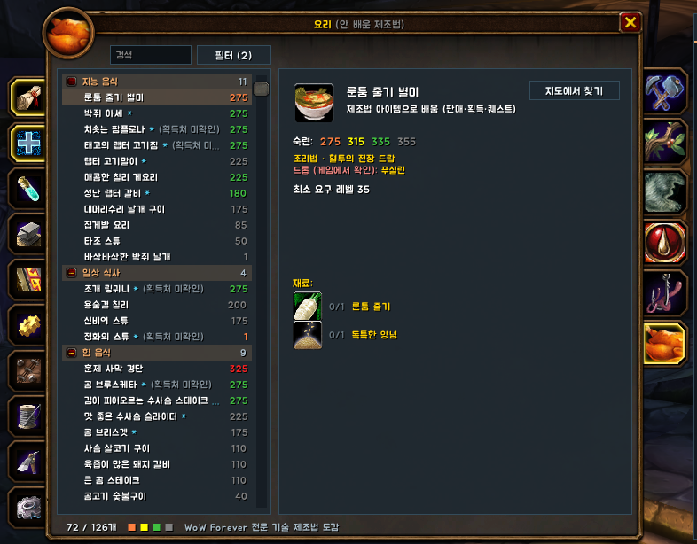
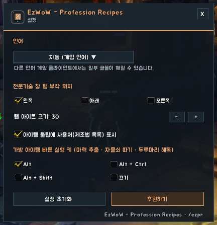
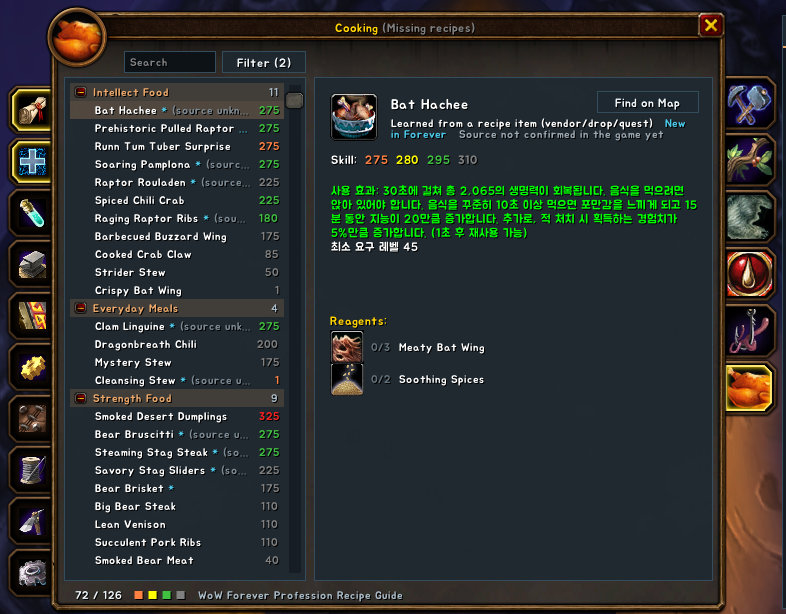
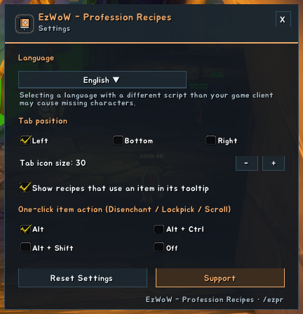

# EzWoW - Profession Recipes (`EzWoW-ProfessionRecipes`)

## CurseForge

- **Project ID / 프로젝트 ID:** `1729781`
- **Project page / 프로젝트 페이지:** [EzWoW-ProfessionRecipes](https://www.curseforge.com/wow/addons/allprofessionrecipes)

**[한국어](#한국어) · [English](#english)**

WoW Forever (`Interface: 16001`) · `/ezpr`

---

## 한국어

### 개요

**12개 전문 기술, 2,232개 제조법**(야영 제조법 포함)의 재료 · 필요 숙련도 · 배우는 곳을 보여 주는 도감입니다. 전문 기술 창 옆에 **배우지 않은 전문 기술 탭**과 **안 배운 제조법 탭**을 붙여 주고, 전문 기술이 하나도 없어도 `/ezpr`로 단독 창을 열어 볼 수 있습니다. 가방 아이템을 보조키 + 클릭 한 번으로 마력 추출 · 자물쇠 따기 · 두루마리 해독하는 기능도 있습니다.

전문 기술: 연금술 · 대장기술 · 마법부여 · 기계공학 · 가죽세공 · 재봉술 · 채광(제련) · 요리 · 응급치료 · 약초 채집 · 무두질 · 낚시(야영 설비)

### 화면 미리보기

> 실제 게임 화면입니다(WoW Forever, 한국어 클라이언트). 캐릭터 · 다른 플레이어 이름과 채팅 내용은 가렸습니다.

### 설치

1. `EzWoW-ProfessionRecipes` 폴더를 `Interface/AddOns/` 폴더에 넣습니다.
2. 캐릭터 선택 화면의 **애드온** 목록에서 켭니다.
3. 전문 기술 창을 열면 옆에 탭이 붙습니다. 단독 창은 `/ezpr`.

### 사용법

| 번호 | 부분 | 설명 |
|---|---|---|
| ① | 전문 기술 전환 바 / 탭 | 단독 창에서는 왼쪽 아이콘으로 12개 전문 기술을 오갑니다. 기본 전문 기술 창을 열면 같은 탭이 창 옆(왼쪽·아래·오른쪽 선택)에 붙고, **두루마리 아이콘 탭**은 지금 열린 전문 기술에서 **아직 배우지 않은 제조법**만 모아 보여 줍니다. |
| ② | 검색 | 한·영 제조법 이름, 재료 이름, 배우는 지역, 주문/아이템 ID로 찾습니다. |
| ③ | 필터 ▼ | 포에버 신규만 · 숙련 225 이하만 · 배운 것 숨기기 · 지금 배울 수 있는 것만 · 모든 전문 기술에서 검색 · 다른 진영 제조법 숨기기 · 획득처 모르는 제조법 숨기기 (배우는 곳이 게임에서 확인되지 않은 제조법은 이름 뒤에 "(획득처 미확인)", 한국어 이름이 없는 미출시 제조법은 목록에 나오지 않음) |
| ④ | 제조법 목록 | 분류별로 접고 펼칩니다. 오른쪽 숫자는 필요 숙련도이며 내 숙련 기준 색(빨강 배울 수 없음 · 주황 · 노랑 · 초록 · 회색)으로 표시됩니다. 이름 뒤 `*`는 포에버 신규 제조법입니다. |
| ⑤ | 상세 정보 | 숙련 단계(주황/노랑/초록/회색), 제작 수량, 배우는 곳(교관, 진영별 판매 상인과 좌표 · 상인의 호의 가격, 드랍 지역, 퀘스트), 재료와 개수. EzWoW 사용자가 게임에서 확인한 교관과 도안 상점·드롭도 “교관 (게임에서 확인)”·“판매 (게임에서 확인)”·“드롭 (게임에서 확인)”으로 나옵니다. |
| ⑥ | 지도에서 찾기 | `EzWoW - Map Finder`로 도안 판매 상인 · 전문가 · 퀘스트 · 획득처를 월드맵에서 찾습니다. 목록의 제조법이나 재료를 **우클릭**해도 같습니다. 배우는 곳에 좌표가 있으면 그 자리에 웨이포인트를 찍고 화면에 방향 화살표(판매자 이름 표시)가 뜹니다. 위치가 없는 제조법은 채팅창에 획득처를 알려 줍니다. |
| ⑦ | 재료 툴팁 | 가방·상점 아이템 툴팁에 그 재료가 쓰이는 제조법 수를 전문 기술별로 표시합니다. **Shift**를 누르면 제조법 이름과 숙련도 목록이 나옵니다. |
| ⑧ | 제조법 아이템 툴팁 | 도안·제조법 아이템 툴팁에 **배움 / 배울 수 있음 (숙련 N 필요) / 숙련 부족**과, 이미 배운 **내 다른 캐릭터**(이름 성, 직업 색)를 표시합니다. 각 캐릭터로 전문 기술 창을 한 번 열면 배운 제조법이 저장됩니다. |

툴팁에 이 애드온이 줄을 추가하면 그 아래 오른쪽에 `EzWoW - Profession Recipes`가 작은 회색 글씨로 한 번만 표시됩니다.

#### 전문 기술 올리기 (`/ezpr level`)

전문 기술 창 옆의 **올리기 탭**(초록 + 아이콘)을 누르면 창 오른쪽에 붙습니다.

- **목표까지 경로**: 지금 숙련도에서 목표(기본은 최고 숙련도 300, `-`·`+`로 5씩, Shift는 25씩)까지 구간마다 무엇을 몇 개 만들지 보여 줍니다. 숙련도마다 **재료비 ÷ 오를 확률**이 가장 낮은 제조법을 고르고(주황은 반드시, 노랑부터는 회색에 가까울수록 확률이 낮아짐), 75·150·225에서 다음 단계를 배울 때를 알려 줍니다. 상급자에게 배울 수 있는 제조법도 넣을지 고를 수 있고(`배우기` 표시), 상급자 제조법으로는 오르지 않는 구간은 상점·드롭 도안으로 채웁니다(`도안 구하기` 표시).
- **단계마다 자세히**: 위쪽 막대에 지금 숙련도 · 배운 단계 상한 · 목표가, 요약 줄에 예상 제작 횟수 · 경매장/상점 비용 · 보유 재료로 아낀 금액이 나옵니다. 단계 아래 줄에는 한 번에 드는 재료, 노랑·초록으로 바뀌는 숙련도, 지금 가방 재료로 만들 수 있는 횟수, 오를 확률(시작 → 끝)이 나옵니다. 툴팁에는 이 단계 재료 합계와 보유량, 배우는 곳(게임에서 확인한 상급자 포함)이 나오고, 오른쪽 클릭하면 배우는 곳을 지도에서 찾습니다.
- **장보기 목록**: 경로 전체에 필요한 재료 합계에서 가방·은행에 있는 것을 빼고, `직접 만들기 · 경매장에서 사기 · 상점에서 사기 · 시세 없음 · 가방·은행에 충분함`으로 나눠 살 개수 · 개당 가격 · 소계를 보여 줍니다. 툴팁에는 쓰이는 단계, 시세를 읽은 시각, 파는 상인(게임에서 확인)이 나옵니다. 두루마리처럼 같은 전문 기술로 만드는 편이 싼 재료는 `만들기`로 나오고, 앞 단계에서 만든 것은 뒤 단계에 먼저 씁니다.
- **경매장 시세**: 경매장을 열 때 모은 최저 즉시 구매가로 계산합니다(EzWoW - Tooltip이나 EzWoW - Bags가 있으면 그 시세를 쓰고, 없으면 이 애드온이 직접 읽음). 상점에서 파는 재료는 상점가가 더 싸면 상점가로 셉니다.
- **전문 기술 창 연동**: 단계를 누르거나 맨 아래 **다음** 버튼을 누르면 전문 기술 창에서 그 제조법을 고르고 만들 개수를 채웁니다. 숙련도가 오르거나 가방이 바뀌면 바로 다시 계산합니다.

#### 원클릭 아이템 실행 (기본 `Alt`)

가방 아이템 위에서 보조키를 누른 채 **좌클릭**하면 바로 실행합니다.

- **마력 추출** (마법부여)
- **자물쇠 따기** (도적 — 내 가방 상자, 거래창 아래 칸 상자)
- **대장기술 해골 열쇠 · 카드가의 잠금 해제 두루마리** 사용
- **포에버 두루마리 해독**
- **사냥꾼 야수 먹이 주기**

보조키는 설정창에서 `Alt` / `Alt + Ctrl` / `Alt + Shift` / `끄기` 중에서 고릅니다.

### 설정창 (`/ezpr config`)

| 번호 | 항목 | 설명 | 기본값 |
|---|---|---|---|
| ① | 언어 | 상자를 누르고 목록에서 자동(게임 언어) 또는 8개 언어를 고릅니다. 게임과 다른 문자의 언어를 고르면 일부 글자가 깨질 수 있습니다. | 자동 |
| ② | 전문기술 창 탭 부착 위치 | 왼쪽 / 아래 / 오른쪽 | 왼쪽 |
| ③ | 탭 아이콘 크기 | 16~48 | 30 |
| ④ | 아이템 툴팁에 사용처(제조법 목록) 표시 | 재료 툴팁 | 켬 |
| ⑤ | 가방 아이템 빠른 실행 키 | Alt / Alt + Ctrl / Alt + Shift / 끄기 | Alt |
| ⑥ | 설정 초기화 · 후원하기 | 모든 설정을 처음으로 되돌립니다. | - |

필터 기본값: 배운 것 숨기기 켬, 다른 진영 제조법 숨기기 켬, 나머지 끔.

### 명령어 (`/ezpr`, `/apr`, `/제조법`, `/전문기술`)

| 명령어 | 설명 |
|---|---|
| `/ezpr` | 단독 제조법 창 열기/닫기 |
| `/ezpr level` (`올리기`) | 전문 기술 올리기 창 열기/닫기 |
| `/ezpr config` (`settings`, `설정`) | 설정창 |
| `/ezpr side` · `bottom` · `left` | 탭 부착 위치 오른쪽 · 아래 · 왼쪽 |
| `/ezpr icon 16~48` | 탭 아이콘 크기 |
| `/ezpr quick <alt\|ctrl\|shift\|off>` | 빠른 실행 보조키 (`ctrl` = Alt+Ctrl, `shift` = Alt+Shift) |
| `/ezpr lang <auto\|ko\|en\|de\|fr\|es\|ru\|cn\|tw>` | 표시 언어 변경 |
| `/ezpr reset` | 모든 설정 초기화 (캐릭터별 배운 제조법 기록은 유지) |
| `/ezpr help` | 도움말 |

### 저장 데이터

- `EzWoW_ProfessionRecipesDB`: 설정, 필터, 접힌 분류, 단독 창 위치, 캐릭터별 배운 제조법(제조법 아이템 툴팁용), 올리기 목표 숙련도, 이 애드온이 직접 읽은 경매장 시세(EzWoW - Tooltip이 없을 때만).

### 다른 EzWoW 애드온과 함께 쓰기

- **EzWoW - Tooltip**: 이 애드온이 재료 툴팁의 “제조법 재료” 줄이나 제조법 아이템의 배움 상태를 보여 주면, EzWoW - Tooltip은 같은 아이템에서 자기 “재료 사용처” 줄과 도안 수집 상태 줄을 생략합니다. 같은 정보가 두 번 나오지 않습니다.
- **EzWoW - Map Finder**: 지도에서 찾기와 우클릭 위치 검색에 필요합니다.

<!-- ezwow-pad-share -->
### 게임패드
- 게임패드 UI를 켜면 EzWoW 창을 패드로 다룰 수 있습니다. 방향키로 이동, A(✕)로 누르기, X(□)로 오른쪽 클릭, LB/RB로 스크롤, B(○)로 닫기입니다. 창 아래에 연결된 패드 모양으로 키 안내가 나옵니다.
- 블리자드 창이 열려 있지 않을 때 **보기(Back) / Create 버튼**을 누르면 화면의 EzWoW 프레임(유틸리티 바, 퀘스트 목록 등)으로 이동합니다. 다시 누르거나 B를 누르면 돌아갑니다.
- 다른 버튼을 쓰려면 설정 > 단축키 > 애드온 > EzWoW > "게임패드: EzWoW 창으로 이동/돌아가기"에 지정합니다(EzWoW-MapFinder가 설치돼 있을 때).

### 기록 공유
- 모든 EzWoW 애드온이 함께 쓰는 기록 공유가 **기본으로 켜져 있습니다**. 직접 확인한 퀘스트 NPC, 희귀 몬스터 목격, 아이템 드롭, 채집 위치를 다른 EzWoW 사용자와 나눕니다.
- `/ezshare` 또는 `/공유`: `on` / `off` 켜기·끄기, `channel on` / `channel off` 서버 채널 사용, `status` 현재 상태와 기록 수.
- 같은 기록을 되풀이해 보내지 않고, 상대에게 없는 기록만 주고받습니다. `/ezshare` 창의 사람 탭에서 상대가 쓰는 공유 버전과 EzWoW 애드온 버전을 볼 수 있습니다.

---

## English

### Overview

A recipe guide for **12 professions and 2,232 recipes** (camping recipes included) with reagents, skill levels and where to learn them. It attaches **unlearned-profession tabs** and a **missing-recipes tab** to the profession window, and `/ezpr` opens a standalone window even if you know no professions. It also adds one-click Disenchant, Pick Lock and scroll deciphering on bag items.

Professions: Alchemy · Blacksmithing · Enchanting · Engineering · Leatherworking · Tailoring · Mining (smelting) · Cooking · First Aid · Herbalism · Skinning · Fishing (camp gear)

### Screenshots

> In-game screenshots with the addon set to English. The game client is Korean, so game text such as zone, item and spell names stays Korean. Character and player names and chat text are blurred.

### Installation

1. Copy the `EzWoW-ProfessionRecipes` folder into `Interface/AddOns/`.
2. Enable it in the **AddOns** list on the character select screen.
3. Open a profession window to see the tabs, or `/ezpr` for the standalone window.

### How to use

| No. | Part | Description |
|---|---|---|
| ① | Profession switcher / tabs | In the standalone window the icons on the left switch between the 12 professions. With the default profession window open, the same tabs attach to its side (left, bottom or right); the **scroll tab** lists only the **recipes you have not learned yet** in the open profession. |
| ② | Search | By Korean/English recipe name, reagent name, zone, spell or item ID. |
| ③ | Filter ▼ | Forever new only · Skill 225 or less · Hide learned · Learnable now only · Search all professions · Hide other faction's recipes · Hide recipes with no known source (recipes with no confirmed way to learn them carry "(source unknown)"; unreleased ones without a Korean name are not listed) |
| ④ | Recipe list | Fold by category. The number is the required skill, coloured against your skill (red not yet · orange · yellow · green · grey). `*` after the name marks a Forever-new recipe. |
| ⑤ | Details | Skill steps (orange/yellow/green/grey), quantity created, where to learn (trainer, faction vendors with coordinates and Merchant's Favor price, drop zones, quests) and reagents. Trainers, recipe shops and drops EzWoW users saw in the game show as “Taught in the game”, “Sold in the game” and “Dropped in the game”. |
| ⑥ | Find on Map | Uses `EzWoW - Map Finder` to show recipe vendors, trainers, quests and sources on the World Map. **Right-clicking** a recipe or reagent does the same. When the place to learn has coordinates, a waypoint goes there and a direction arrow shows the seller's name; recipes with no place get their source in chat. |
| ⑦ | Reagent tooltip | Bag and vendor tooltips show how many recipes per profession use the item. Hold **Shift** for recipe names and skill levels. |
| ⑧ | Recipe item tooltip | Recipe items show **Learned / Can learn (requires skill N) / Skill too low** and which of **your other characters** already know it (first name and surname, class colour). Open the profession window once on each character to save its learned recipes. |

When this addon adds lines to a tooltip, `EzWoW - Profession Recipes` appears once below them on the right in small grey text.

#### Level up (`/ezpr level`)

The **Level up tab** (green + icon) beside the profession window opens a window on its right.

- **Path to a target**: from your skill to the target (by default the highest skill, 300; `-`/`+` by 5, Shift by 25), what to make and how many in each range. At each skill it takes the recipe with the lowest **material cost ÷ chance of a skill-up** (orange always, from yellow on the chance falls towards grey) and marks where to train the next rank (75, 150, 225). Recipes a trainer teaches can be included (`learn` tag); ranges no trainer recipe covers are filled with vendor or drop recipes (`get recipe` tag).
- **Step details**: a bar with your skill, training cap and target, and a summary (about how many crafts, auction / vendor cost, what your bags save). Under each step: the materials of one craft, where it turns yellow / green, how many your bags allow now and the skill-up chance (start → end). The tooltip lists the step's materials with what you have and where to learn it (trainers seen in the game too); right-click finds that on the map.
- **Shopping list**: the materials for the whole path, less what your bags and bank hold, grouped as `Make · Buy at the auction house · Buy from vendors · No price · Enough in bags and bank` with the count, price each and subtotals. The tooltip shows the steps that use it, when the price was read and the vendors seen selling it. Materials the same profession makes for less (bolts of cloth) show as `make`, and what an earlier step made is used first.
- **Auction prices**: the lowest buyout read when the auction house is open (EzWoW - Tooltip's or EzWoW - Bags' prices when installed, otherwise this addon reads them). Vendor materials count at the vendor price when that is lower.
- **Profession window**: clicking a step, or the **Next** button at the bottom, picks the recipe in the profession window and fills in the count. It recalculates as your skill rises or your bags change.

#### One-click item actions (default `Alt`)

Hold the modifier and **left-click** a bag item:

- **Disenchant** (Enchanting)
- **Pick Lock** (Rogue — your lockboxes and the trade window's bottom slot)
- Use **Blacksmithing skeleton keys / Khadgar's unlocking scrolls**
- **Decipher Forever scrolls**
- **Feed Pet** (Hunter)

Choose the modifier in settings: `Alt` / `Alt + Ctrl` / `Alt + Shift` / `Off`.

### Settings window (`/ezpr config`)

| No. | Option | Description | Default |
|---|---|---|---|
| ① | Language | Click the box and pick Auto (game language) or one of 8 languages from the list. A script different from your client may show missing characters. | Auto |
| ② | Tab position | Left / Bottom / Right | Left |
| ③ | Tab icon size | 16–48 | 30 |
| ④ | Show recipes that use an item in its tooltip | Reagent tooltip | On |
| ⑤ | One-click item action key | Alt / Alt + Ctrl / Alt + Shift / Off | Alt |
| ⑥ | Reset Settings · Support | Restores every setting. | - |

Filter defaults: Hide learned on, Hide other faction's recipes on, the rest off.

### Slash commands (`/ezpr`, `/apr`, `/제조법`, `/전문기술`)

| Command | Description |
|---|---|
| `/ezpr` | Open/close the standalone recipe window |
| `/ezpr level` | Open/close the Level up window |
| `/ezpr config` (`settings`) | Settings |
| `/ezpr side` · `bottom` · `left` | Attach tabs right · bottom · left |
| `/ezpr icon 16-48` | Tab icon size |
| `/ezpr quick <alt\|ctrl\|shift\|off>` | Quick-action modifier (`ctrl` = Alt+Ctrl, `shift` = Alt+Shift) |
| `/ezpr lang <auto\|ko\|en\|de\|fr\|es\|ru\|cn\|tw>` | Change display language |
| `/ezpr reset` | Reset all settings (learned recipes saved per character are kept) |
| `/ezpr help` | Help |

### Saved data

- `EzWoW_ProfessionRecipesDB`: settings, filters, collapsed categories, standalone window position, learned recipes per character (for recipe item tooltips), Level up targets, auction prices this addon read itself (only without EzWoW - Tooltip).

### Working with other EzWoW addons

- **EzWoW - Tooltip**: when this addon shows the “Reagent for” lines on a reagent or the learned status on a recipe item, EzWoW - Tooltip leaves out its own “Used In” and recipe collection lines for that item, so nothing shows twice.
- **EzWoW - Map Finder**: needed for Find on Map and right-click map search.

### Gamepad
- With the gamepad UI on, EzWoW windows work with a gamepad: D-pad to move, A (✕) to press, X (□) for right-click, LB/RB to scroll, B (○) to close. A key guide in your pad's button style shows under the window.
- With no game window open, press **View (Back) / Create** to move to the EzWoW frames on screen (Utility Bar, quest list and more). Press it again or B to go back.
- To use another button, set Key Bindings > AddOns > EzWoW > "Gamepad: move to / leave the EzWoW frames" (with EzWoW-MapFinder installed).

### Record sharing
- Record sharing, used by all EzWoW addons, is **on by default**. Quest NPCs, rare monster sightings, item drops and gathering spots you have seen yourself are shared with other EzWoW users.
- `/ezshare`: `on` / `off` to turn it on or off, `channel on` / `channel off` for the server channel, `status` for the current state and record counts.
- Records are not sent again and again: players exchange only what the other side does not have yet. The Players tab of the `/ezshare` window shows each player's sharing version and EzWoW addon versions.

---

## Support / 후원

If you find this addon useful, you can support its development.

애드온이 도움이 되셨다면 개발 후원으로 응원해 주세요.

[Buy Me a Coffee ☕](https://buymeacoffee.com/qqhrqqhr2)

